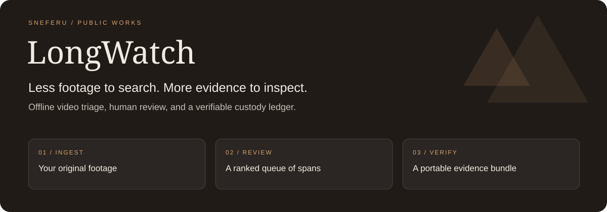

<p align="center">
  <a href="docs/USER_GUIDE.md"><strong>User guide</strong></a> ·
  <a href="docs/OPERATIONS.md">Installation</a> ·
  <a href="docs/API.md">API reference</a> ·
  <a href="https://ebj2525d.clients.sneferu.ai/sod/open-builds#build/f7fc4294-dfdc-5ee4-a6f0-bb17252a066d/idea-740b1c1c58b6">The Public Works build</a>
</p>

LongWatch turns a large collection of existing video into a **ranked queue of spans for a person to review**. It keeps the footage local, records how derived files were produced, and packages selected excerpts with a custody ledger and verification tools.

Built with **[Sneferu Software on Demand](https://sneferu.ai/sod)** through Public Works: application code, interface, tests, and full product documentation are included here.

## The workflow

| Bring your footage | Review what matters | Share a verifiable bundle |
| --- | --- | --- |
| Ingest local files; record source digests and processing history. | Inspect ranked spans with measured reasons, a working proxy, and a source-resolution view. | Export selected excerpts, human decisions, hashes, and the custody record. |

The human makes the judgment. LongWatch ranks material for examination; it does not determine whether conduct is abusive, lawful, or humane. Its integrity records start when the software receives a file.

## Inside the repository

| Layer | Included |
| --- | --- |
| Application | Python / FastAPI service, PostgreSQL state and job queue |
| Interface | React / TypeScript review workbench |
| Media processing | ffmpeg / ffprobe, CPU ONNX inference |
| Integrity | Source digests, custody ledger, portable bundle verification |
| Documentation | User, operations, architecture, API and UI guides; runnable examples |

## Run it locally

Start with the **[installation and configuration guide](docs/OPERATIONS.md)**. The source build requires Python 3.12, PostgreSQL 16, Node 22, ffmpeg/ffprobe, and the documented model files. Docker builds also fetch model artifacts; normal processing is designed for offline use.

```sh
git clone https://github.com/sneferu-ai/longwatch.git
cd longwatch
python3 -m venv .venv
. .venv/bin/activate
pip install -e '.[dev]'
bash scripts/build_spa.sh
```

After supplying the documented model files and your own PostgreSQL `DATABASE_URL`:

```sh
python -m longwatch migrate
python -m longwatch serve --host 127.0.0.1 --port 8000
```

Open **http://localhost:8000**. See the [original generated README](README.generated.md#quick-start) for the complete Docker recipe, model configuration, persistent storage, authentication options, and test commands. Use synthetic or non-sensitive footage for your first evaluation.

## Explore the full documentation

- **[User guide](docs/USER_GUIDE.md)** — ingest, triage, review, export and verification.
- **[Operations](docs/OPERATIONS.md)** — installation, environment, startup, recovery and troubleshooting.
- **[Architecture](docs/ARCHITECTURE.md)** — components, data model and design decisions.
- **[API](docs/API.md)** and **[UI](docs/UI.md)** — routes, screen behavior and error states.
- **[Runnable examples](docs/examples/README.md)** — health, ingest, review, export and ledger walkthroughs.

## Source and evaluation status

This is a **source showcase** of the preserved Public Works build. LongWatch has an accepted project release; this repository publishes the filtered source export, not the signed-off delivery image or a new release qualification. The original application files are unchanged. This presentation README and banner are additions; the generated README is preserved as [`README.generated.md`](README.generated.md).

[`SOURCE_SNAPSHOT.json`](SOURCE_SNAPSHOT.json) records the source identity and file hashes. This publication does not claim a new end-to-end validation of the application. Review the documentation, tests and configuration before using it with real evidence.

## License

Application source: **[MIT](LICENSE)**. The original LICENSE also records the separate terms for model artifacts fetched during image construction, including the AGPL-3.0 detector and Apache-2.0 face model. Those weights are not included in this repository.

---

**From an idea to software you can inspect.** Explore [Public Works](https://ebj2525d.clients.sneferu.ai/sod/open-builds), or learn about [Sneferu Software on Demand](https://sneferu.ai/sod).
