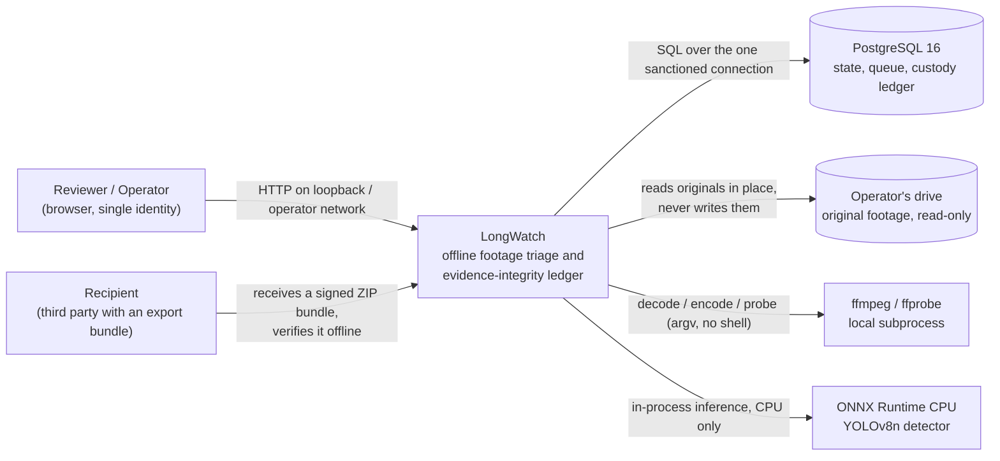
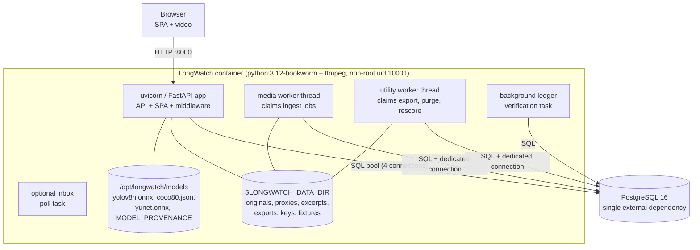
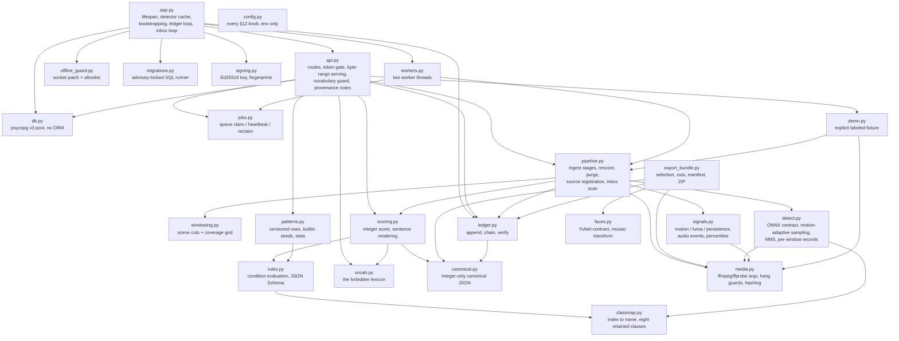
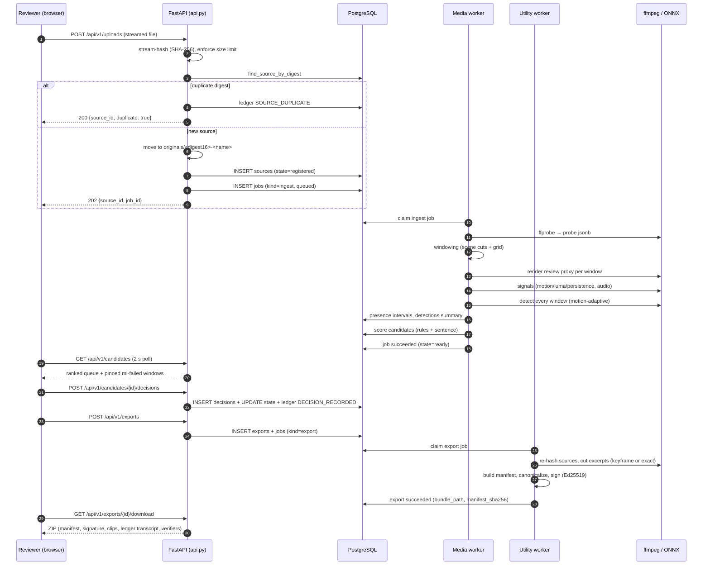
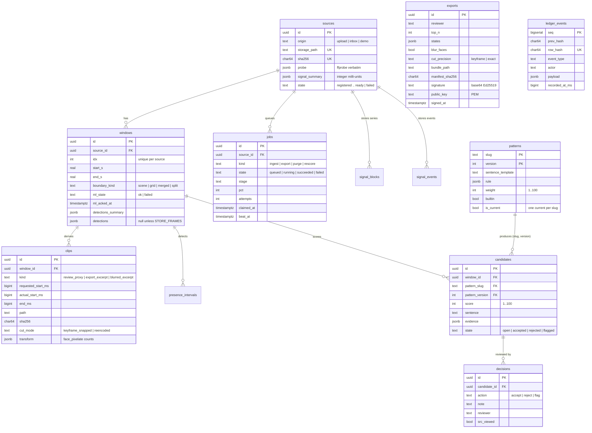

# LongWatch — architecture

This document explains how LongWatch is built, why it is built that way, and what
each moving part is responsible for. It reflects the code in this repository,
not an idealized design.

---

## 1. Project shape

LongWatch is **one FastAPI service plus one React single-page application served
from the same origin**, with PostgreSQL 16 for state, queue, and custody ledger.
There is no second service, no message broker, no object store, and no ORM.

| Concern | Choice | Source of truth |
|---|---|---|
| HTTP API + SPA host | FastAPI + uvicorn | `longwatch/api.py`, `longwatch/app.py` |
| Frontend | React 18 + TypeScript + Vite, built into `longwatch/static/` | `frontend/` |
| State, queue, ledger | PostgreSQL 16 via psycopg v3 raw cursors | `migrations/`, `longwatch/db.py` |
| Media | ffmpeg / ffprobe (subprocess, argv, no shell) | `longwatch/media.py` |
| Detection | ONNX Runtime on CPU, one session | `longwatch/detect.py` |
| Custody | Append-only hash-chained ledger + Ed25519-signed bundles | `longwatch/ledger.py`, `longwatch/export_bundle.py` |
| Packaging | one root `Dockerfile` (spa → deps → models → runtime) | `Dockerfile` |

The Python package is deliberately flat — one module per load-bearing structure,
named after the specification section it implements (`longwatch/` contains no
sub-packages except `static/`).

---

## 2. C4 — Context

Who and what touches LongWatch. Note the absence of network peers: the system is
an offline appliance whose only sanctioned egress is DNS resolution of the
configured database hostname.



The export bundle leaves by the operator's own hand (browser download or file
copy). LongWatch itself never sends anything outward.

---

## 3. C4 — Containers

One deployable container. Inside it: the uvicorn server process, two worker
threads, and the filesystem layout under `$LONGWATCH_DATA_DIR`.



Why two worker threads rather than one pool or a separate worker container:

- A separate worker container would starve the pipeline — the execution profile
  is smaller than what ffmpeg plus ONNX Runtime need (see `longwatch/workers.py`).
- One shared thread would serialize a multi-day corpus ingest behind exports.
  The split keeps exports, purges, and re-scores available during an ingest:
  slower under contention, never unavailable.

---

## 4. Components

Inside the Python package. Arrows point from caller to callee.



Module responsibilities, one line each:

| Module | Responsibility |
|---|---|
| `api.py` | HTTP surface: routes, optional bearer gate, byte-range media serving, vocabulary guard at the boundary, model provenance sentences. |
| `app.py` | Application assembly: lifespan (guard → migrate → key → workers → verification loop), detector cache, uvicorn entry. |
| `config.py` | The complete environment-variable surface; one `Config` dataclass read once at process start. |
| `db.py` | A fixed psycopg v3 connection pool (size 4) with `dict_row`; no ORM, explicit SQL everywhere. |
| `offline_guard.py` | Patches `connect` / `connect_ex` / `sendto` / `sendmsg` / `getaddrinfo` so any non-allowlisted egress is a crash, not a leak. |
| `migrations.py` | Applies `migrations/NNN_*.sql` in filename order under a Postgres advisory lock; creates `schema_migrations` itself. |
| `pipeline.py` | The ingest stages (probe → windows → proxies → signals → detect → score), re-score, purge, source registration, inbox scan. |
| `windowing.py` | Scene-cut detection unioned with a coverage grid; clamps; guaranteed coverage. |
| `signals.py` | Deterministic per-second motion/luma/persistence in milli-units, audio silence/spike events, nearest-rank percentile summaries. |
| `detect.py` | ONNX model contract enforcement, motion-adaptive sampling, per-window detection records, failure isolation per window. |
| `classmap.py` | The declared index→name class map and the eight retained classes; fails closed on a swapped model. |
| `rules.py` | Pattern rule validation and evaluation; the published JSON Schema. |
| `scoring.py` | Integer 0–100 scores; deterministic sentence rendering; placeholder vocabulary. |
| `patterns.py` | Versioned `(slug, version)` rows, builtin seeds, per-version stats. |
| `vocab.py` | The forbidden lexicon, enforced at three points. |
| `ledger.py` | Append-only chain: byte-exact hash preimage, advisory-locked appends, full and incremental verification. |
| `canonical.py` | The integer-only canonical JSON form; refuses floats, non-ASCII keys, out-of-int64 integers. |
| `signing.py` | Ed25519 keypair lifecycle on the data volume; public key fingerprint. |
| `export_bundle.py` | Bundle assembly: source re-hash, excerpt cuts, CSV, manifest, signature, checksums, ZIP. |
| `faces.py` | YuNet contract check and the face-mosaic transform; fails closed when the model is absent. |
| `media.py` | Every ffmpeg/ffprobe invocation as an argv subprocess with hang guards; streaming hasher; rawvideo ring. |
| `jobs.py` | Queue: enqueue, claim by kind, heartbeat, stale-lease reclaim. |
| `workers.py` | The media worker and utility worker threads over the queue. |
| `demo.py` | The explicit, labeled synthetic fixture (no environment default). |

---

## 5. Primary flow — ingest to evidence

The sequence below is the full path a video takes from upload to a downloadable,
signed bundle. It is the flow the product guide walks a human through.



Every step that writes state also writes a ledger row or a job stage update —
the custody record is built as the work happens, not reconstructed afterward.

---

## 6. Data model

The two migrations create fourteen tables; the diagram draws the nine every
review-facing flow touches and the text names the other five. (The migrator's
own `schema_migrations` bookkeeping table is created by `migrations.py` itself,
before any migration file runs.) All timestamps are `timestamptz`; all digests
are lowercase hex `char(64)`; all timeline positions are source-relative
seconds. Every quantity that can enter a hashed payload is stored or derived as
an integer in milli-units — the `real` columns are renderings for query
convenience and are never hash inputs.



Not drawn above (to keep the diagram readable): `reviewers` (the single
configured identity, stamped for attribution), `signal_blocks` (bounded series
blocks per source), `signal_events` (silence gaps, loudness spikes, audio
absence), `presence_intervals` (merged, source-wide presence spans, with a
`synthetic` flag for demo data), and `ledger_verify_state` (the incremental
verification checkpoint). The `exports` table has no foreign key to `jobs`:
an export job names its export row in `jobs.detail` (`export_id=<uuid>`), which
is how `GET /api/v1/exports` joins the two.

Full DDL lives in `migrations/001_core_tables.sql` and
`migrations/002_ledger.sql`.

### The ledger's immutability

- Row-level triggers do not fire on `TRUNCATE`, so the guard is three
  statement-level triggers: `BEFORE UPDATE`, `BEFORE DELETE`, and
  `BEFORE TRUNCATE`, each raising `ledger_immutable`.
- The chain itself is computed in application code (a generated column cannot
  reference other rows). Appends are serialized by a transaction-scoped advisory
  lock held only across short SQL-only transactions — **no ffmpeg, zip, or file
  work ever runs inside a DB transaction**, so a long export never serializes
  behind (or blocks) a ledger append.
- The byte-exact preimage:

  ```
  row_hash = sha256(UTF-8 bytes of
    "longwatch-ledger-v1|" + decimal(seq) + "|" + prev_hash + "|" +
    event_type + "|" + actor + "|" + decimal(recorded_at_ms) + "|" + canonical_json)
  ```

  `decimal(x)` is the base-ten rendering of the non-negative integer `x` — no
  sign, no padding, no separators, no exponent. Row N carries
  `prev_hash = row_hash(N−1)`; the genesis row's `prev_hash` is 64 zeros. The
  genesis timestamp travels in `ledger.jsonl` like every other row, so
  verification needs no out-of-band constants.

### Integer-only hashed data

Floats are forbidden in any hashed payload or signed manifest document —
`ledger.append` and the manifest builder validate recursively and raise on any
float. Time spans are integer milliseconds, normalized 0–1 values and
confidences are integer thousandths, percentiles are integer percent. The
canonical form (ASCII keys sorted by code point, no whitespace, RFC 8259 minimal
escaping) is exactly what `json.dumps(obj, sort_keys=True,
separators=(",", ":"), ensure_ascii=False)` produces for this type set, and what
default encoders produce in JavaScript, Go and Rust once keys are sorted.
Portability is proven, not asserted: twelve canonical vectors ship in
`tests/fixtures/canonical_vectors.json` and the `CANON` scenario reproduces every
one in Python **and** through an independent JavaScript canonicalizer executed
under Node.

---

## 7. Key design decisions

Twelve settled points, each with the rejected twin named. The full table is in
the specification (§3); this is the working summary.

1. **Lossy review proxy + keyframe-snapped excerpts + a recorded source-resolution view.** Browsers cannot play arbitrary source codecs, so a playable proxy is unavoidable; the evidentiary artifact must reproduce the original's encoded frames bit-for-bit, which only a keyframe-snapped cut provides. The gap between judgment medium and evidence medium is disclosed in every manifest and CSV **and** mitigated by the `v` source pane — and every decision records whether it was used (`src_viewed`).
2. **ML runs on every window** with motion-adaptive sampling — never a skip gate. The flagship pattern is *animal stationary while person present*; stationary content is exactly low-motion content, so a skip gate would blind the pattern that matters most. Throughput is recovered by sampling static windows sparsely, not by not looking.
3. **Optional bearer token, default off**, compared with `secrets.compare_digest`, with `Referrer-Policy: no-referrer` on every response. It is an accident guard, not access control, and both the README and the UI say so.
4. **Ledger chain in application code** with statement-level `BEFORE TRUNCATE`; appends serialized by an advisory lock held only across short SQL transactions.
5. **COCO ids fixed to {person 0, truck 7, bird 14, cat 15, dog 16, horse 17, sheep 18, cow 19}**, mapped **by name** at load time via the declared class map. A model swap that does not declare a matching class map fails readiness closed.
6. **Scores are integers 0–100; every hashed numeric value is an integer in milli-units.** Floats are designed out of the ledger and manifest, not rounded into portability.
7. **The bundle carries its own root of consistency**: the public key, the canonical manifest bytes, the signature, the full ledger transcript, and digests of every other bundle file — including both verifier scripts.
8. **Patterns are `(slug, version)` rows** with one `is_current` per slug; edits create a new version, are ledgered with the counts of decided candidates carried over, and queue a re-score job. **Exports are decision-scoped, not version-scoped** — an accepted candidate stays export-eligible forever, so tuning a rule can never delete accepted evidence from a future bundle.
9. **No OpenCV, no ORM.** Frame math is numpy over ffmpeg rawvideo pipes; psycopg v3 raw cursors with explicit SQL.
10. **The job pool is split into a media worker and a utility worker** so exports, purges, and re-scores stay available during a multi-day corpus ingest.
11. **The demo seed is an explicit operator action**, never an environment default that writes synthetic rows into a production evidence database.
12. **Originals are read-only.** Ingested files are opened for reading, streamed through a hasher, and referenced by path. No code path renames, moves, re-encodes, truncates or deletes an original; the only deletions are of LongWatch's own derived artifacts, under the operator-invoked retention purge, and every deletion is a ledger event. Source rows are never deleted in v0.

---

## 8. Security posture (what is enforced, and how)

| Refusal | Enforcement | Where |
|---|---|---|
| No verdict channel | The forbidden lexicon lives in one module; enforced at three points: pattern writes (`PUT /patterns` → 422), decision notes (422), and the rendered sentence before a candidate is persisted (treated as an invariant violation: not persisted, logged at ERROR, recorded on the job). | `longwatch/vocab.py`, `longwatch/scoring.py`, `longwatch/api.py` |
| Originals are read-only | The ingest path opens sources for reading only; the only deletion code is the retention purge, which deletes rows/files of derived artifacts and ledgers each one. There is no API or CLI path that deletes a source row. | `longwatch/pipeline.py`, `longwatch/media.py` |
| No egress except the DB host's DNS | A startup socket guard patches `connect`, `connect_ex`, `sendto`, `sendmsg`, and `getaddrinfo`; any non-allowlisted destination raises `OfflineViolation` before a packet leaves the machine. `bind`/`listen`/`accept` stay untouched so uvicorn can serve. A literal-IP DSN eliminates even the DNS step. | `longwatch/offline_guard.py` |
| No capture path | Absence: no RTSP listener, no device control, no always-on watcher exists in the repository. The only inputs are a browser upload and an operator-invoked directory scan. | repository-wide |

Additional hard rules enforced in code: uploaded filenames are sanitized before
any path is built (`_safe_name`); SPA asset serving is traversal-proof; the
export refuses rather than silently skipping when face pixelation is requested
without a usable face model; and a source digest mismatch at export time aborts
the export and records `SOURCE_DIGEST_MISMATCH` in the ledger.

---

## 9. Deployment and runtime model

- **One image, one process.** The Dockerfile builds four stages: `spa` (Vite
  build), `deps` (Python venv), `models` (fetch + digest-verify the detector and
  face model; a fetch that cannot run falls back to a plain file copy of the
  committed contract fixture — no network, no `pip` — and the two fetches are
  independent, so one dead URL never costs the build the other artifact),
  `runtime` (python:3.12-bookworm + ffmpeg, non-root uid 10001, `VOLUME /data`).
- **Entrypoint sequence** (`scripts/entrypoint.sh`): require `DATABASE_URL` →
  wait for the database (bounded loop) → export the image-recorded model digests
  → `python -m longwatch migrate` (idempotent; the runner creates
  `schema_migrations` itself; builtin patterns seed idempotently on
  `(slug, version)`; the genesis ledger row is ensured) → `exec python -m
  longwatch serve`.
- **Server lifespan** (`longwatch/app.py`): install the offline guard first →
  ensure directories → re-check migrations (no-op) → load the signing key →
  run one full incremental ledger verification → start both worker threads →
  start the background verification loop, and the inbox poll loop when
  `LONGWATCH_INBOX_POLL_S > 0`.
- **Durability:** `$LONGWATCH_DATA_DIR` (default `/data`) holds originals,
  proxies, excerpts, exports, the generated Ed25519 key, and the fixture.
  Persist it. **Losing the key invalidates future signatures, never past ones** —
  every past bundle carries its own key and stays verifiable.
- **Re-deployment semantics:** a re-deployment against an empty volume starts a
  **new ledger** (new genesis row); it does not attempt to restore an old chain.
  Old bundles remain fully verifiable from their own `ledger.jsonl`. Restore the
  data volume for chain continuity across a rebuild.
- **CPU only.** ONNX Runtime runs with `LONGWATCH_ORT_THREADS` (default 1)
  intra-op threads, sequential — the box is expected to be busy with ffmpeg.

---

## 10. What is deliberately not built (v0)

Named for v1, not stubbed: independent reviewer accounts with inter-rater
statistics; S3/object-store ingest; a graphical pattern builder; custom class
groups and free-text class naming (v0 restricts both to fixed sets); SSE or
websocket progress (the UI polls at 2 s); full recall reporting against
hand-labeled seed sets; RFC 3161 anchoring; multi-worker scale-out; source
deletion as an explicit ledgered operation. The schema admits each additively.

Permanently refused: live or continuous surveillance; species or behavior
classification; automated welfare-rubric scoring; case/dossier management;
charge mapping; chronology construction; GPU dependence; cloud processing; any
runtime outbound call other than the database host's DNS.

---

## Where to next

- [README](../README.md) — overview and quick start.
- [Product guide](USER_GUIDE.md) — the operator's journey.
- [API reference](API.md) — every route and its shapes.
- [UI reference](UI.md) — screens, states, and the keyboard model.
- [Operations](OPERATIONS.md) — configuration, deployment, troubleshooting.
