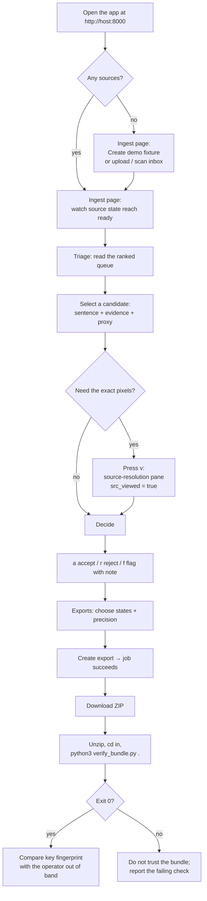
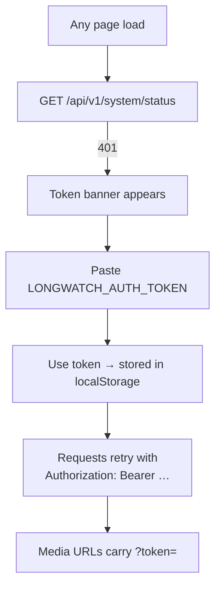
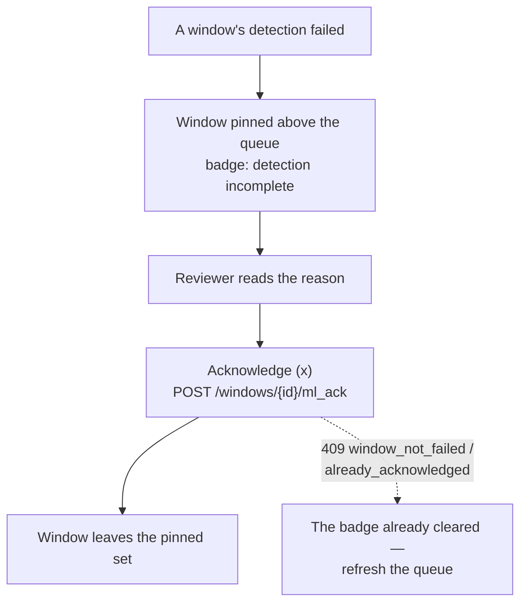

# LongWatch — UI reference

LongWatch ships a React single-page application served by the same FastAPI
process from `longwatch/static/`. There is no separate frontend server, no CDN
reference, and no external asset host — the SPA bundles everything locally.

- **Source:** `frontend/src/` (React 18 + TypeScript, built with Vite)
- **Served by:** `GET /` and `GET /{path:path}` in `longwatch/api.py`
- **Design tokens:** `frontend/src/styles/tokens.css` (`:root` custom properties — background, panel, line, text, muted, accent, warn, bad, good; the light theme is the `[data-theme='light']` block in the same file). `DESIGN.md` is the design system document; `frontend/scripts/token-audit.mjs` fails the build on any raw colour, size or duration outside `tokens.css`, and `frontend/scripts/contrast-audit.mjs` checks every text/surface pair the interface renders.
- **Polling:** the app polls `GET /api/v1/system/status` every 5 s (`App.tsx`); the Ingest sources table every 5 s and an open source detail every 2 s; the Triage ranked queue every 2 s (`Triage.tsx` `POLL_MS`); the Exports list every 3 s; Patterns and its stats every 5 s; a running re-score job every 2 s until it reaches a terminal state. There are no websockets or SSE in v0.

---

## 1. Screen inventory

| Page | Nav id | Purpose | Primary API calls |
|---|---|---|---|
| **Ingest** | `ingest` | Bring footage in: upload, scan the inbox, or create the labeled demo fixture. Watch source states. | `GET /sources`, `POST /uploads`, `POST /ingest/scan`, `POST /demo/seed` |
| **Triage** | `triage` | The workbench: ranked queue, proxy player, source-resolution pane, decisions. | `GET /candidates`, `GET /candidates/{id}`, `POST /candidates/{id}/decisions`, `POST /windows/{id}/ml_ack`, `GET /sources/{id}` |
| **Patterns** | `patterns` | Inspect and tune concern patterns; every save creates a new version and queues a re-score. | `GET /patterns`, `GET /patterns/stats`, `PUT /patterns/{slug}`, `GET /jobs/{id}` |
| **Exports** | `exports` | Cut a signed bundle; watch the job; download the ZIP. | `GET /exports`, `POST /exports`, `GET /exports/{id}/download` |
| **Settings** | `settings` | Optional token entry, signing-key fingerprint, ledger verification, retention purge. | `GET /system/status`, `GET /ledger/verify`, `POST /retention/purge` |
| **About** | `about` | The disclosures, verbatim: integrity statement, time basis, review medium, detector limits, person-absent rule, trust boundary, scope. | `GET /system/status` (disclosures) |

### Persistent chrome

- **Header** — brand, six tabs, and a service badge reading
  `db ok · model ok` (or `down`) from the 5 s status poll.
- **Model-limits disclosure strip** — always visible under the header; the
  sentence comes from `system/status.disclosures.model_limits`, which appends
  the detector-provenance note (fixture / fetched / fetched_unpinned /
  operator-supplied). This strip is deliberately permanent, not conditional.
- **Token banner** — appears when any API call returns `401`: a password field
  and a **Use token** button. The token is stored in `localStorage` and attached
  as an `Authorization` header, and as `?token=` on the two media URLs.
- **Error banner** — any non-auth API error string.

---

## 2. Page detail

### Ingest

- **Upload** — file picker + **Upload** button. Streams
  `multipart/form-data` to `POST /api/v1/uploads`. Messages: `uploading <name>…`,
  `ingest queued (job …)`, `duplicate digest — registered as source …`, or the
  error status and body.
- **Scan inbox** — `POST /api/v1/ingest/scan`; message `scan registered N file(s)`.
  Returns 400 with the named reason when `LONGWATCH_INBOX_DIR` is unset or missing.
- **Create demo fixture (labeled synthetic)** — shown only while no sources
  exist. Calls `POST /api/v1/demo/seed`; message names the job and states that
  synthetic presence is labeled.
- **Sources table** — name (with a `demo · synthetic` badge for demo rows and a
  failure reason under the name when present), state badge, origin, duration,
  window count, pending jobs.
- **System strip** — offline-guard state, sanctioned egress, and the
  unacknowledged ml-failed window count.

**Empty state:** `no sources yet — upload a file, scan the inbox, or create the
labeled demo fixture`.

### Triage

The two-pane workbench: ranked queue on the left, detail on the right.

- **Queue** — every row shows score, pattern slug and version, the sentence, and
  the source/span/state line. Detection-incomplete windows (`ml_failed`) are
  pinned **above** ranked candidates with a `detection incomplete` badge, the
  reason, and a note that spans the machine could not look at come first.
- **Detail (candidate)** — pattern title + score badge + state badge, the
  sentence, the review-proxy player, the evidence JSON block (`measured values,
  milli-units`), and the decision history.
- **Detail (ml_failed)** — the reason and an **Acknowledge (x)** button
  (`POST /windows/{id}/ml_ack`).
- **Actions** — Accept / Reject / Flag, Note toggle, Source view toggle, and a
  `source viewed: true|false` indicator. Clicking **Flag** records immediately
  with the note field's current contents; the `f` key opens the note field
  first (press `f` again, or `Enter` in the field, to record).
- **Note field** — placeholder text tells the reviewer to describe observables;
  `Enter` records the flag, `Shift+Enter` is a newline. A forbidden term returns
  `422 vocabulary_breach`, and the UI renders `the term "…" is not permitted`
  with the guidance string.
- **Source-resolution pane** — the original file streamed by byte-range into a
  second player, with a fallback message naming the storage path when the
  codec is not browser-playable. Opening it sets `src_viewed`, which rides the
  decision, the CSV, and the manifest.

**Empty state:** `queue is empty`. **No proxy:** `no review proxy for this
window`. **No selection:** `select a queue entry`.

### Patterns

- Pattern select (one entry per slug), current-version badge, and a raw-JSON
  editor pre-filled with `{title, sentence_template, rule, weight, enabled}`.
- **Save as a new version** — `PUT /api/v1/patterns/{slug}`; success message
  `version N saved; rescore job … queued` and a live `rescore <state> <pct>%`
  indicator polling the job.
- **Version history** table and **Stats** table (fired / accepted / rejected /
  flagged / precision estimate, with the note that this is reviewer agreement,
  not recall).
- Invalid JSON is reported as `invalid JSON: <message>`; API validation errors
  (vocabulary, template, rule) render with their named reason.

### Exports

- **New export form** — state checkboxes (`open`, `accepted`, `rejected`,
  `flagged`), cut-precision select (`keyframe` — stream copy, lead-in included;
  `exact` — re-encode, no lead-in), **pixelate faces** checkbox (fails closed
  without a face model), and `top_n`. The form initializes **once** from
  `system/status.export_defaults` so the deployment's `LONGWATCH_BLUR_FACES` /
  `_EXPORT_TOP_N` / `_EXPORT_STATES` are the visible defaults without the 5 s
  status poll clobbering an in-progress edit.
- **Exports table** — id (first 8), states, precision, job state + percent,
  created, and a **download ZIP** link (intercepted so the bearer token rides as
  a header — the download route refuses `?token=` by design). While the bundle
  builds the cell reads `building…`.

### Settings

- **Optional bearer token** — password field + **Save token** (stored in
  `localStorage`), with the trust-boundary text from `system/status.auth`.
- **Signing key** — the fingerprint (SHA-256 of `public.pem`) with the
  instruction to compare it with recipients out of band.
- **Ledger** — **Verify chain now** (`ok=… length=… head=… first_divergence=…`)
  and **Purge derived artifacts** (with the explicit note that it never touches
  originals or source rows).

### About

Renders the disclosure strings verbatim: the integrity statement, time basis,
review medium, detector limits + provenance, the person-absent rule, the trust
boundary, and the scope paragraph (no capture path; zero outbound connections
other than the database host's DNS).

---

## 3. User flows

### Primary journey — ingest to signed bundle



### Token entry (only when the deployment sets one)



### Detection-failure acknowledgement



---

## 4. Keyboard model (Triage)

Keys are ignored while a text field has focus, so typing a note never triggers
an action.

| Key | Action |
|---|---|
| `j` / `k` | next / previous queue entry |
| `space` | play / pause the proxy player |
| `a` | accept |
| `r` | reject |
| `f` | open the note field; press `f` again (or `Enter` in the field) to record the flag with the note |
| `n` | toggle the note field |
| `v` | toggle the source-resolution pane (sets `src_viewed`) |
| `x` | acknowledge a detection failure |
| `?` | toggle the shortcut help |

The same legend is always printed under the detail pane, and `?` opens the full
panel.

---

## 5. States the UI can show

| State | Where | What the user sees |
|---|---|---|
| Loading | Header badge | `loading…` until the first status poll returns. |
| Database down | Header badge | `db down · model …`. |
| Model down | Header badge | `db … · model down`. The About page still shows the detector-limits and provenance text; `/healthz` names the actual failure. |
| Fixture provenance | Model-limits strip, About | The provenance sentence for `fixture` — detections are placeholders. |
| Empty queue | Triage | `queue is empty`. |
| Empty source list | Ingest | The empty-state row naming the three ingest paths. |
| Job running | Ingest table `jobs` column, Exports table | `N pending`, or `running <pct>%`. |
| Job failed | Exports table | The error text under the job state. |
| Vocabulary breach | Triage / Patterns message line | `vocabulary_breach: the term "…" is not permitted — <guidance>`. |
| Unauthorized | Any page | Token banner (see flow above). |
| Generic error | Any page | Error banner with the API error string. |

---

## 6. Local development and deployment

**Dev server** (frontend hot-reload against a locally running backend):

```sh
cd frontend
npm ci
npm run dev        # Vite dev server; /api and /healthz are proxied to 127.0.0.1:8000
```

The proxy is configured in `frontend/vite.config.ts`
(`'/api': 'http://127.0.0.1:8000'`), so run `python -m longwatch serve` in
another terminal first.

**Production build:**

```sh
scripts/build_spa.sh      # npm ci (if needed) + npm run build into longwatch/static/
```

`npm run build` runs `tsc --noEmit` first, so a type error fails the build. The
Dockerfile's `spa` stage performs the same build and copies the output into the
runtime image; `LONGWATCH_SPA_OUT` redirects the output directory for that stage.
If the SPA is missing at runtime, every SPA route returns
`503 {"error": "spa_not_built"}`.

**Where the built assets land:** `longwatch/static/` (declared as package data in
`pyproject.toml`, so a wheel or sdist carries the built SPA).

---

## 7. API-to-UI map

| API | UI affordance |
|---|---|
| `POST /api/v1/uploads` | Ingest → Upload |
| `POST /api/v1/ingest/scan` | Ingest → Scan inbox |
| `POST /api/v1/demo/seed` | Ingest → Create demo fixture (empty-state only) |
| `GET /api/v1/sources` | Ingest → Sources table (5 s poll) |
| `GET /api/v1/sources/{id}` | Triage → source-resolution pane fallback (storage path) |
| `GET /api/v1/sources/{id}/original` | Triage → source-resolution player |
| `GET /api/v1/clips/{id}/proxy` | Triage → review-proxy player |
| `GET /api/v1/candidates` | Triage → ranked queue (2 s poll) |
| `GET /api/v1/candidates/{id}` | Triage → detail pane |
| `POST /api/v1/candidates/{id}/decisions` | Triage → Accept / Reject / Flag |
| `POST /api/v1/windows/{id}/ml_ack` | Triage → Acknowledge (x) |
| `GET /api/v1/patterns` | Patterns → select + version history (5 s poll) |
| `GET /api/v1/patterns/schema` | Named in the Patterns editor heading (`Rule JSON (validated against /api/v1/patterns/schema)`) |
| `GET /api/v1/patterns/stats` | Patterns → Stats table (5 s poll) |
| `PUT /api/v1/patterns/{slug}` | Patterns → Save as a new version |
| `POST /api/v1/exports` | Exports → Create export |
| `GET /api/v1/exports` | Exports → Exports table (3 s poll) |
| `GET /api/v1/exports/{id}/download` | Exports → download ZIP (header-auth fetch) |
| `GET /api/v1/jobs/{id}` | Ingest/Patterns/Exports job progress |
| `POST /api/v1/retention/purge` | Settings → Purge derived artifacts |
| `GET /api/v1/ledger/verify` | Settings → Verify chain now |
| `GET /api/v1/system/status` | Header badge, disclosure strip, Settings, About, Exports defaults (5 s poll) |
| `GET /healthz` | Not surfaced in the UI; the operator health endpoint |

Routes with no UI affordance by design: `GET /api/v1/sources/{id}/timeline` and
`GET /api/v1/sources/{id}/signals` (timeline data for programmatic consumers),
and `GET /api/v1/exports/{id}` (detail; the list view is sufficient for the
operator). The API reference documents all of them.

---

## Where to next

- [README](../README.md) — overview and quick start.
- [Product guide](USER_GUIDE.md) — the operator's journey, with recovery steps.
- [API reference](API.md) — every route and its shapes.
- [Architecture](ARCHITECTURE.md) — how the pieces fit together.
- [Operations](OPERATIONS.md) — configuration, deployment, troubleshooting.
